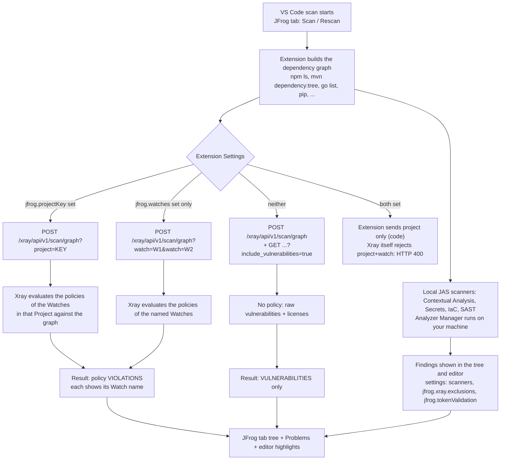
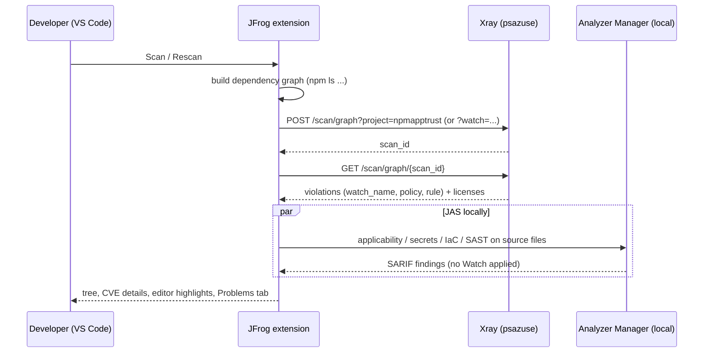

# Lab: JFrog IDE scan in VS Code with `npm-swagger-editor`

Demo the **JFrog extension for Visual Studio Code**: scan the workspace from the IDE (shift-left), see CVEs, Contextual Analysis, Secrets, IaC, SAST, licenses and policy violations *before* a commit reaches Frogbot, and understand how **Xray Watches/Projects decide which policies the IDE applies**.

| | |
|---|---|
| Repo | `ps-jfrog/npm-swagger-editor` (this repo) |
| JFrog instance | `https://psazuse.jfrog.io` (`jf config show psazuse`), Xray 3.156.18 |
| Project / Watch (already created for the Frogbot lab) | project `npmapptrust`, Watch `npmapptrust-swagger-editor-frogbot` |
| Extension | **JFrog** (`JFrog.jfrog-vscode-extension`, 2.15.0 reviewed) |
| Docs | <https://docs.jfrog.com/security/docs/visual-studio-code-1>, Xray policies and Watches: <https://docs.jfrog.com/security/docs/manage#xray-policies-and-watches> |
| Related labs | [`docs/usefrogbotv3.md`](usefrogbotv3.md) (Frogbot, PR/commit scans, the same Watch), SwampUp 2025 LAB-2 (section 9) |

## 1. What to demo on which branch

| Branch | What the IDE shows | Use it for |
|---|---|---|
| `main` | the real swagger-editor app: about 1,300 npm components, a handful of sub-High CVEs, many operational-risk items, no secrets/IaC/SAST seeds | "normal project, realistic noise", exclusions, performance, the Watch/Project settings experiments |
| `demo/frogbot-findings` | the same plus `demo/frogbot-findings/`: Critical/High CVEs with **applicable** contextual analysis, a GPL-3.0 package (license violation), a Catalog-flagged malicious test package, fake **secrets** and a private key, **Terraform IaC** misconfigurations, **SAST** (command injection, eval, SQLi, XSS, SSRF, path traversal, weak hash...), all mapped to policies | the full IDE tour (section 5) |

The seeded folder is **intentionally vulnerable and fake**. Never merge it into `main` (see `usefrogbotv3.md` section 17).

## 2. How the IDE decides which policies/Watches apply

### 2.1 Short version

The IDE has **no repository context**. Unlike Frogbot (which sends the Git clone URL and lets Xray find the Watches attached to that repo), the VS Code extension applies exactly what you type in **Extension Settings**:

- `jfrog.projectKey`: apply the policies of the Watches that belong to this JFrog Project, or
- `jfrog.watches`: apply these named Watches, or
- neither: **no policy** at all, you see plain vulnerabilities (and licenses), not violations.

### 2.2 Decision flow (verified)





ASCII summary for slides / terminals:

```
 Extension Settings                        Xray call                               What you see
 ───────────────────────────────────────   ─────────────────────────────────────   ─────────────────────────────
 jfrog.projectKey = npmapptrust       ──▶  scan/graph?project=npmapptrust     ──▶  violations from ALL Watches in the project
 jfrog.watches = [npmapptrust-...]    ──▶  scan/graph?watch=npmapptrust-...   ──▶  violations from the named Watches only
 (nothing)                            ──▶  scan/graph  (+include_vulnerab.)   ──▶  plain CVEs, no policy, no Watch names
 both                                 ──▶  extension sends project=; Xray 400s if both reach it
```

### 2.3 Evidence (run on `psazuse`, 2026-10-22)

The extension calls Xray's graph scan; I replayed the same call with a 5-component graph (lodash 4.17.15, minimist 1.2.0, glpk.js 4.0.1, `@step-security/malware-simulator@0.0.3`, request 2.88.2):

| Request | Result |
|---|---|
| `scan/graph?watch=npmapptrust-swagger-editor-frogbot` | **9 violations**, all `watch_name = npmapptrust-swagger-editor-frogbot`: lodash (Critical + 2 High CVE), minimist (Critical CVE), malware-simulator (Critical, policy rule `malicious-packages`), glpk.js (GPL-3.0, rule `ban-copyleft`), 3 operational-risk (request, lodash, minimist) |
| `scan/graph?project=npmapptrust` | the **same** violations (the Watch is project-scoped, so the project key pulls it in) |
| `scan/graph?project=npmapptrust&watch=<watch>` | **HTTP 400** `invalid graph scan parameters combination` |
| `scan/graph?watch=no-such-watch` | **HTTP 400** `ensure that all watches in the list exist in Xray` |
| `scan/graph` (+ `include_vulnerabilities=true`) | **0 violations, 8 vulnerabilities** (plain CVEs, no policy, no Watch name) |

Source evidence (`jfrog-vscode-extension` 2.15.0, `jfrog-client-js` 2.9.0 as pinned): `Configuration.getProjectKey()` / `getWatches()` feed only `scanGraphLogic.scan()` -> `connectionManager.scanWithGraph()`; `XrayScanClient.getUrl()` appends `project=<key>` **first** and only `else` `watch=<w1>&watch=<w2>`; the Watch name of each violation is shown in the issue details.

> **Pitfall to know before the demo:** the settings tooltip says "If both Project Key and Watches are configured, VS Code will use the configured Watches, not the Project Key", and the debug log prints `Using Watches: [...]`, but the shipped client code builds the request from the **Project key first**. Set **only one** of them so the result is unambiguous.

> **JAS scanners (Contextual Analysis, Secrets, IaC, SAST) do not take a Watch.** In the extension source, only the dependency-graph scan carries the project/watches. Those findings are shown as findings (severity, file, line), not as Watch violations. Confirm it live in step 6.

### 2.4 Is a new Watch required?

**No.** The Watch created for the Frogbot lab works as is:

| Option | Settings | Notes |
|---|---|---|
| A (recommended) | `"jfrog.projectKey": "npmapptrust"` | picks up **every** Watch in the project (today: only `npmapptrust-swagger-editor-frogbot`). New project Watches show up in the IDE automatically. Verified |
| B | `"jfrog.watches": ["npmapptrust-swagger-editor-frogbot"]` | explicit and predictable, good for a controlled demo. Verified |
| C (optional) | create a dedicated "IDE" Watch + policies | only if you want the IDE to show different rules than Frogbot (for example *warn only*). The IDE never fails anything: policy actions **Fail Build / Fail Pull Request are ignored**, the IDE only displays violations. Create it in Xray > Watches, resource type per your needs, then point `jfrog.watches` at it |

Why the Watch applies although its resource is a **Git repository** (`github.com/ps-jfrog/npm-swagger-editor.git`): the IDE scan names the Watch (option B) or the Project (option A) explicitly, so Xray evaluates its policies without matching any repo. Frogbot is the one that resolves Watches from the repo URL (see `usefrogbotv3.md` FAQ Q15).

Caveat: the Watch in this project also carries the **operational-risk policy** (report only). In the IDE it adds one violation per risky package; that is expected noise. Remove it from the Watch if it distracts.

## 3. Prerequisites

| Item | Check |
|---|---|
| VS Code 1.82+ | `code --version` |
| Node.js and npm | `node -v` (>= 18; the app asks for >= 24.21 to *build*; scanning only needs `npm ls` to work) |
| Xray >= 3.66.5, JFrog Advanced Security entitlement (Contextual Analysis, Secrets, IaC, SAST) | confirmed on psazuse |
| Credentials | either JFrog CLI configured (`jf config show psazuse`; the extension detects it), or SSO, or URL + access token |
| Repo cloned | `git clone git@github.com:ps-jfrog/npm-swagger-editor.git` |

Install the extension: Extensions view (`Cmd/Ctrl+Shift+X`), search **JFrog**, install; a **JFrog** frog icon appears in the activity bar. CLI: `code --install-extension JFrog.jfrog-vscode-extension`.

Optional: a second extension `JFrog.jfrog-sast-extension` (JFrog SAST: Run Scan, Show SAST Issues Dashboard, `jfrog-sast.scanOnSave.enabled`) for a dedicated SAST experience.

## 4. Step by step: connect and configure

1. **Open the JFrog tab** and sign in. Options on the sign-in page:
   - **JFrog CLI detected:** click the notification "Sure!" / use the detected `psazuse` server (user `svenkate`).
   - **SSO:** *Continue with SSO*, enter `https://psazuse.jfrog.io`.
   - **Manual:** URL + access token (Advanced = separate Artifactory/Xray URLs).
2. **Open Extension Settings** (gear icon in the JFrog tab, or `Cmd/Ctrl+,` and search `jfrog`). Settings of the extension:

   | Setting | Value for this lab |
   |---|---|
   | `jfrog.projectKey` | `npmapptrust` (**or** use `jfrog.watches`, not both) |
   | `jfrog.watches` | `["npmapptrust-swagger-editor-frogbot"]` |
   | `jfrog.xray.exclusions` | default `**/*{.git,test,venv,node_modules,target}*` (note: `test` is excluded, so the repo's `test/` is skipped) |
   | `jfrog.tokenValidation` | `true` to validate detected secrets (Dynamic Token Validation) |
   | `jfrog.excludeDevDependencies` | `true` to ignore devDependencies (npm only; shrinks `main`'s noise) |
   | `jfrog.logLevel` | `debug` for the demo (shows `Sending dependency graph ... Using Watches/Project key`) |
   | `jfrog.externalResourcesRepository` | an Artifactory remote of `releases.jfrog.io` for air-gapped machines |
   | `jfrog.customRulesPath` | JSON file with custom JAS rules |

   Or edit `settings.json` (workspace scope keeps the demo self-contained):
   ```jsonc
   // .vscode/settings.json  (do not commit; pick ONE of projectKey / watches)
   {
     "jfrog.projectKey": "npmapptrust",
     "jfrog.logLevel": "debug",
     "jfrog.tokenValidation": true
   }
   ```
3. **Open the folder** `npm-swagger-editor` in VS Code (`File > Open Folder`). Use a *multi-root* or open `demo/frogbot-findings` directly if you only want the seeded folder.
4. **Install dependencies** (npm scanning uses `npm ls`, so they must exist):
   ```bash
   # root app (main): large, takes a few minutes
   npm install --ignore-scripts --no-audit --no-fund
   # seeded demo folder (demo/frogbot-findings branch)
   (cd demo/frogbot-findings && npm install --ignore-scripts --no-audit --no-fund)
   ```
   `--ignore-scripts` matters: the demo includes `@step-security/malware-simulator`, whose `preinstall` makes one harmless HTTPS call.
5. **Scan:** JFrog tab > **Scan / Rescan**, or **Start Xray Scan** in the editor. Open *Output > JFrog* to follow the log.

## 5. Demo script

### 5.1 Baseline on `main` (3 minutes)

1. `git switch main`, install deps, scan. Show: the **tree** (project node > `package.json` > vulnerable dependencies, indirect ones tagged **(indirect)**), severity icons, and that without a Project/Watch the IDE shows **vulnerabilities**; with the setting it shows **violations** and the **Watch name**.
2. Click a CVE: the **vulnerability details** view (impacted component, fixed versions, impact path, JFrog Research summary). Use the editor **light bulb** to jump from `package.json` to the tree node.
3. Show the noise problem and the controls: `jfrog.excludeDevDependencies`, `jfrog.xray.exclusions`, the **Filter** (severity/license), **Add ignore rule**.

### 5.2 Full tour on `demo/frogbot-findings` (10 minutes)

```bash
git switch demo/frogbot-findings
cd demo/frogbot-findings && npm install --ignore-scripts --no-audit --no-fund && cd ..
code .
```
Rescan, then walk through the tree:

| What to open | What you see | Talking point |
|---|---|---|
| `demo/frogbot-findings/package.json` | lodash 4.17.15 (Critical + High CVEs, XRAY-959813, XRAY-140575, XRAY-114089), minimist 1.2.0 (XRAY-200203), axios, express, jsonwebtoken, request | SCA with fix versions. Violations list the **Watch** `npmapptrust-swagger-editor-frogbot` and the policy rule (`cve-high-critical`) |
| same file, `@step-security/malware-simulator` | Critical **malicious package** (XRAY-257512) | harmless EICAR-like test package flagged by the Catalog; policy rule `malicious-packages` |
| same file, `glpk.js` | **License violation** GPL-3.0 (`ban-copyleft`) | license policy visible in the IDE; no blocking, just display |
| `src/server.js` | **Contextual Analysis**: lodash/minimist CVEs marked **Applicable** because the code calls `_.merge`, `_.template`, `_.zipObjectDeep`, `minimist()`; **SAST** nodes (command injection, `eval`, path traversal, XSS, SQLi, open redirect, SSRF, weak hash, cookie flags) | click a finding: the exact line is highlighted and listed in **Problems**. CVEs that are *Not Applicable* get a grey icon |
| `src/config.js` | **Secrets**: hardcoded `apiKey`/`clientSecret`/`serviceToken`, **private key** | with `jfrog.tokenValidation=true` active tokens are validated. Suppress a finding with a `// jfrog-ignore` comment on the line above (try it, rescan) |
| `iac/main.tf` | **IaC**: public S3 ACL, `0.0.0.0/0` security group, unencrypted public DB | Terraform only |
| any CVE > right-click | **Ask Copilot to Fix** (needs the Unified/Ultimate Security Bundle and GitHub Copilot; Curation checks if the remote MCP server is on) | optional AI remediation |

### 5.3 The Watch/Project experiment (5 minutes, the "how are Watches used" demo)

Change one setting at a time, press **Rescan**, and watch the tree and the `Output > JFrog` log (`jfrog.logLevel=debug`):

| # | Settings | Expected | Log line |
|---|---|---|---|
| 1 | neither `projectKey` nor `watches` | **plain vulnerabilities**, no Watch name, no policy rule, licenses listed | `Sending dependency graph ... to Xray for analyzing.` |
| 2 | `jfrog.projectKey = npmapptrust` | **violations**, each tagged with `npmapptrust-swagger-editor-frogbot` | `... Using Project key: npmapptrust` |
| 3 | `jfrog.projectKey` empty, `jfrog.watches = ["npmapptrust-swagger-editor-frogbot"]` | same violations | `... Using Watches: [npmapptrust-swagger-editor-frogbot]` |
| 4 | `jfrog.watches = ["no-such-watch"]` | the scan **fails**: Xray answers `400 ensure that all watches in the list exist in Xray` (verified) | error in the log |
| 5 | **Live policy change:** in Xray, edit `npmapptrust-frogbot-security` (for example raise `cve-high-critical` to `Critical`), Rescan | the High CVEs disappear from the violations | the **policy** drives the IDE, no setting change |
| 6 | both set | only **one** is used (the code prefers the project key, the tooltip claims Watches); do not demo this live, mention it | - |

Close the loop with Frogbot: the same Watch and policies produce the **PR comment and the red check** (`usefrogbotv3.md`), so a developer sees the same finding in the IDE first.

### 5.4 Other views (2 minutes)

- **CI view:** switch to **CI mode**; **Builds** lists Artifactory builds (set `jfrog.view.ciIntegration.buildNamePattern`, `*` for all). Shows build scan status and artifact security.
- **Local view** continuously rescans on file save for supported descriptors (watch the scan status bar).

### 5.5 Extra capabilities from the JFrog how-to pages

Sources: [Quick start (source code)](https://docs.jfrog.com/security/docs/quick-start-source-code) (VS Code extension: Local and CI modes) and [How-tos (source code)](https://docs.jfrog.com/security/docs/how-tos-source-code-1) (written for "the IDE"; it never names VS Code, so confirm each item in the extension while you rehearse). Neither page covers Watches, the Project key or settings; that part is section 2.

| Capability | How to demo it | Notes |
|---|---|---|
| **CVE quick fix** | in `demo/frogbot-findings/package.json`, open a vulnerable **direct** dependency (for example `lodash` 4.17.15) and use the fix action offered at the vulnerable location in the editor (light bulb) | updates the dependency to a fixed version. Direct dependencies only; the page does not give the exact menu wording, so check it in the extension. Rescan afterwards: the CVEs should drop. Revert with `git checkout -- demo/frogbot-findings/package.json` |
| **JFrog Research enrichment** | open a CVE (for example XRAY-959813): **JFrog Severity** (likelihood of exploitation), a research summary of the applicability conditions, and remediation steps | only for selected issues |
| **Contextual Analysis detail** | in the CVE details view check the applicability status, its breakdown and the contextual remediation | needs Xray >= 3.66.5 and the Advanced Security entitlement (confirmed on psazuse) |
| **SAST data flow** | open a SAST finding in `src/server.js`: data-flow analysis, fix steps and risk severity | injection (SQL, command, code, SSRF) and unsafe API use (encryption, signing, file operations) |
| **Secrets ignore rule** | add a comment containing `jfrog-ignore` on the line above a secret in `src/config.js`, rescan | the finding disappears. Remove the comment to bring it back |
| **Ask Copilot to Fix** | right-click a SAST, Secrets, IaC or CVE finding in the JFrog pane > **Ask Copilot to Fix**; a pre-filled Copilot chat opens | needs GitHub Copilot and the **Unified or Ultimate Security Bundle**. Optionally enable the JFrog remote MCP server so dependency upgrades are checked against Curation policy. The page warns that AI output must be reviewed before you act on it |
| **Severity icon legend** | point at the icons in the tree | Critical, High, Medium, Low, Unknown, plus **Not Applicable** (the CVE exists in the dependency but your code does not use the vulnerable path) |
| **Local vs CI mode** | switch with the button next to the components tree | **Local**: continuous workspace scan (**Scan/Rescan** or **Start Xray Scan** in the editor). **CI**: build status, links to CI logs and security info for build artifacts and dependencies |

CI mode setup (optional, needs a CI that publishes builds to Artifactory):

1. Configure the CI pipeline so it publishes build info to Artifactory (JFrog CLI `jf rt build-publish`, or the CI plugin).
2. Switch the extension to **CI** mode.
3. Extension Settings > **Build name pattern** (`jfrog.view.ciIntegration.buildNamePattern`): the build name, or `*` for all builds.
4. Click **Builds** and select the build to display; the JFrog panel shows its status and the security data of its artifacts and dependencies.

## 6. IDE scan vs Frogbot (positioning)

| | JFrog IDE (VS Code) | Frogbot v3 |
|---|---|---|
| When | while coding, before commit | on PR / push (CI) |
| Policy context | **you configure** project key or watches in settings | automatic: Git repo URL + `JF_PROJECT_KEY` -> Watches (`FAQ Q15`) |
| Fails something | never (display only; `Fail Build/PR` actions ignored) | yes: exit code 3 on Fail Build / Fail Pull Request |
| Dependency graph | local build tool (`npm ls`...) | installed deps / lockfile in CI |
| JAS | local Analyzer Manager, findings without Watch | same scanners, results can become violations (secrets did) |
| Config | VS Code settings | Config Profile in the platform |
| Output | tree, editor highlights, Problems | PR comment, check, SARIF, Xray Scans List |

## 7. Troubleshooting

| Symptom | Cause / fix |
|---|---|
| 0 issues on an npm project | dependencies not installed (`npm install` first); `jfrog.xray.exclusions` excluded the folder (`test`, `target`, `node_modules`...) |
| Plain CVEs but no violations / no Watch name | neither `jfrog.projectKey` nor `jfrog.watches` set, or the Project has no Watches |
| Project key set but no violations | the Project has no active Watch with policies; check Xray > Watches (project scope) |
| `invalid graph scan parameters combination` | project and watch sent together; keep one |
| Violations differ from Frogbot | different scope: IDE scans the workspace dependency graph only; Frogbot also evaluates repo-level JAS results and may use different Watches (repo-resolved) |
| JAS findings missing | no Advanced Security entitlement on the server, Xray < 3.66.5, unsupported language, or the Analyzer Manager download is blocked (set `jfrog.externalResourcesRepository`) |
| Scan hangs on a huge app | exclude folders, `excludeDevDependencies`, or demo only `demo/frogbot-findings` |
| `maven`/`pip`/`go`/`.NET` notes | Go CLI on PATH; Maven `dependency:tree` (disabled if dependency-plugin include/exclude is configured); pip needs an activated venv with `pipdeptree` and the Python extension; NuGet `packages.config` needs the `nuget` CLI; Yarn v1 only |
| Proxy | VS Code `http.proxy` settings or `HTTP(S)_PROXY`; `http.proxyAuthorization` for auth |

## 8. Cleanup

```bash
# workspace settings and node_modules are local; nothing to remove on the platform
rm -rf node_modules demo/frogbot-findings/node_modules .vscode/settings.json
git switch main
```
(`demo/frogbot-findings/node_modules` is ignored on the demo branch; do not commit it.)

## 9. JFrog IDE lab in the SwampUp 2025 repo

There is a ready-made IDE scan lab from SwampUp 2025, session **JFTD-114 "Compliant SDLC Without Compromise"**:
<https://github.com/jfrog/SwampUp2025/tree/main/JFTD-114-Compliant_SDLC_Without_Compromise/LAB-2>

| | |
|---|---|
| Title | **LAB-2: Identify Secrets & Malicious Indicators** (Xray and JAS; "Dev persona: IDE; SBOM and vulnerability remediation") |
| Content | `readme.md` (steps), `setup-repos.sh`, `java-app/` (source forked from **WebGoat**), `express-js-appbundle/`, `images/vscode-0..7.png`, a recorded walkthrough <https://youtu.be/ZvYLXtMYtD4> |
| Flow | open the JFrog extension -> sign in with JFrog CLI ("Sure!") -> open `LAB-2/java-app` -> automatic scan -> list of dependency issues -> open e.g. `profile.js` and read the finding in the **PROBLEMS** tab (severity and exact line) |
| Lab environment | pre-provisioned lab server (`academy-artifactory`, user `admin`); you need your own instance to repeat it (use `psazuse` here) |
| Neighbouring labs in the session | **LAB-1** OSS filtering with a curated remote repo (Curation waivers, blocking GPL-3.0), **LAB-3** JFrog RLM and Evidence (build, SBOM, evidence, release bundle v2 promotion) |

How to combine: use the SwampUp lab for the **Java/WebGoat** and *"malicious indicators"* storyline, and this document for the **npm** storyline with the project's Watch and the seeded `demo/frogbot-findings` content (Node, Terraform, secrets, SAST).

## 10. References

- JFrog extension for VS Code: <https://docs.jfrog.com/security/docs/visual-studio-code-1>
- Xray policies and Watches in the IDE: <https://docs.jfrog.com/security/docs/manage#xray-policies-and-watches> (two options: JFrog Project, or Xray Watches)
- IDE overview: <https://jfrog.com/help/r/jfrog-security-user-guide/shift-left-on-security/ides>
- Quick start (Local and CI modes, severity icons): <https://docs.jfrog.com/security/docs/quick-start-source-code>
- How-tos (viewing vulnerabilities, Contextual Analysis, SAST, Secrets, IaC, CVE quick fix, Ask Copilot to Fix): <https://docs.jfrog.com/security/docs/how-tos-source-code-1>
- JFrog remote MCP server: <https://jfrog.com/help/r/jfrog-integrations-documentation/enable-the-jfrog-mcp-server>
- JFrog Security Research: <https://research.jfrog.com>
- Extension source: <https://github.com/jfrog/jfrog-vscode-extension> (`src/main/utils/configuration.ts`, `scanLogic/scanGraphLogic.ts`, `connect/connectionManager.ts`; settings in `package.json`)
- Graph scan client: <https://github.com/jfrog/jfrog-client-js> (`src/Xray/XrayScanClient.ts`, `getUrl`)
- Frogbot lab and FAQ for the same Watch: [`usefrogbotv3.md`](usefrogbotv3.md)
- SwampUp 2025 JFTD-114: <https://github.com/jfrog/SwampUp2025/tree/main/JFTD-114-Compliant_SDLC_Without_Compromise>
