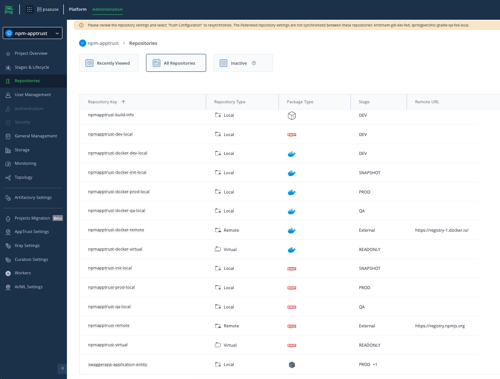
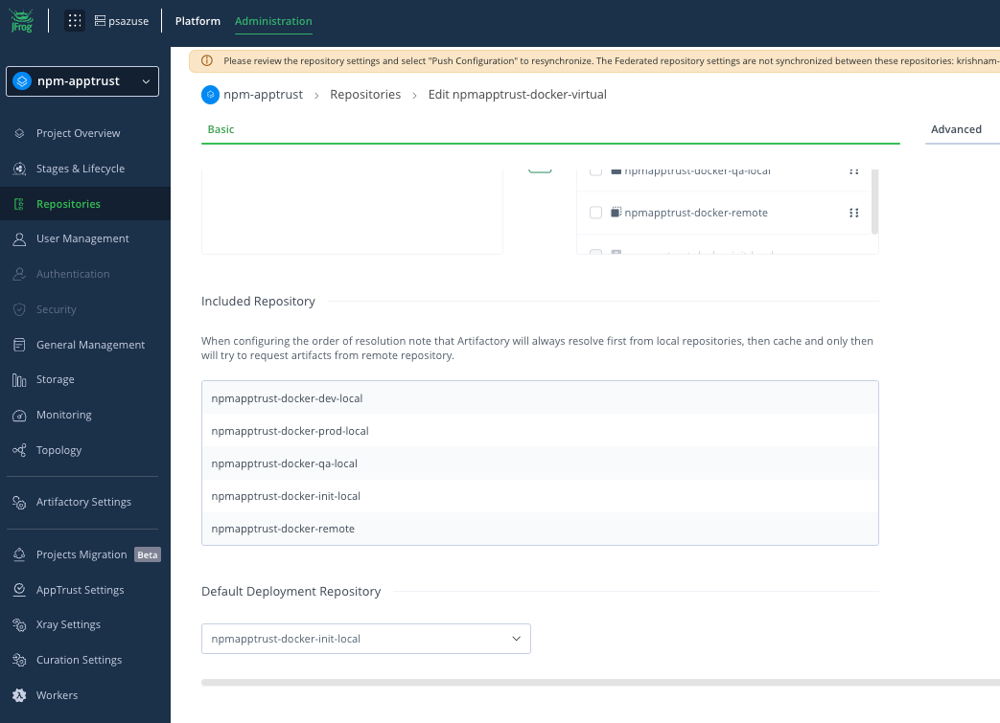
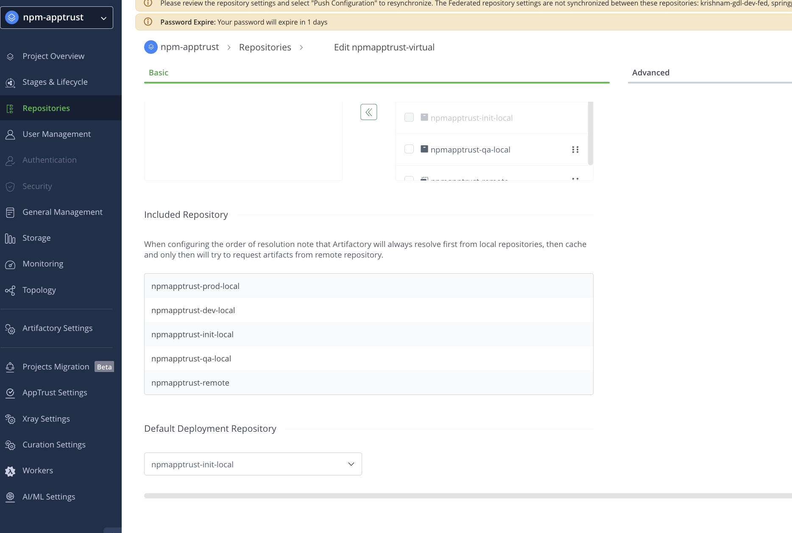
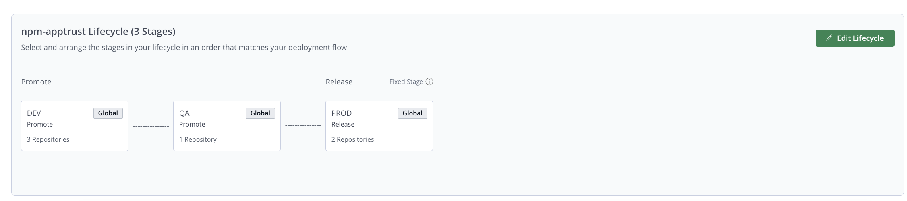
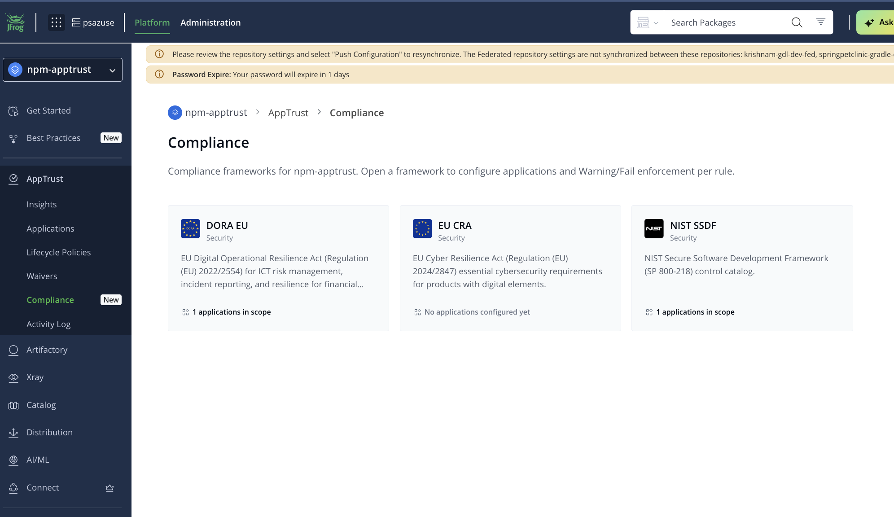
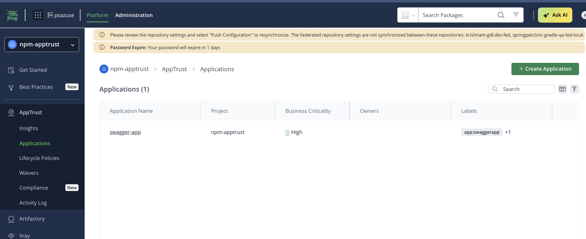
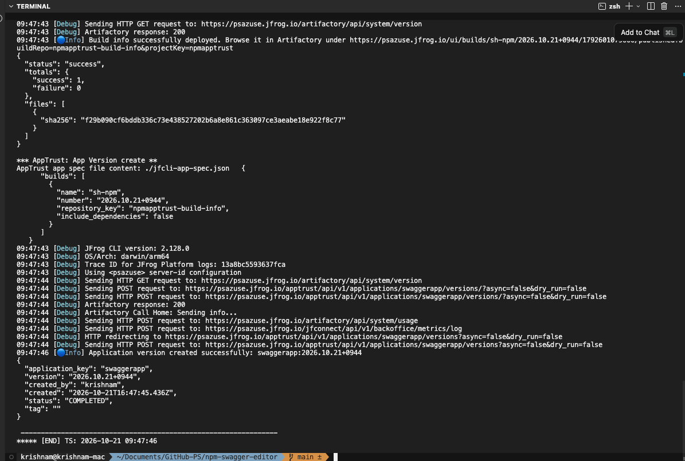
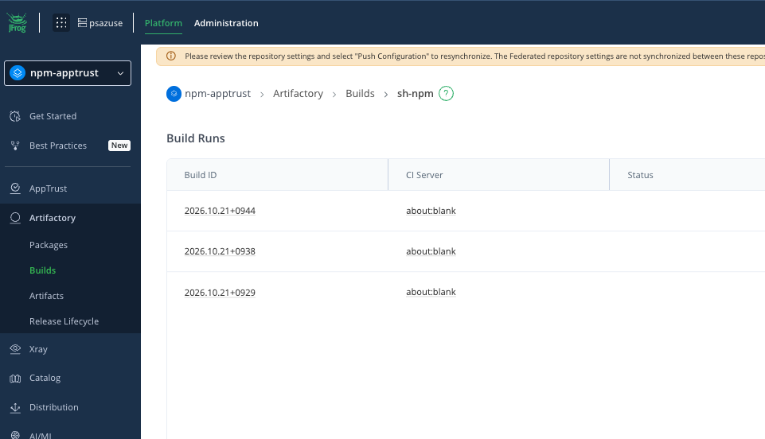
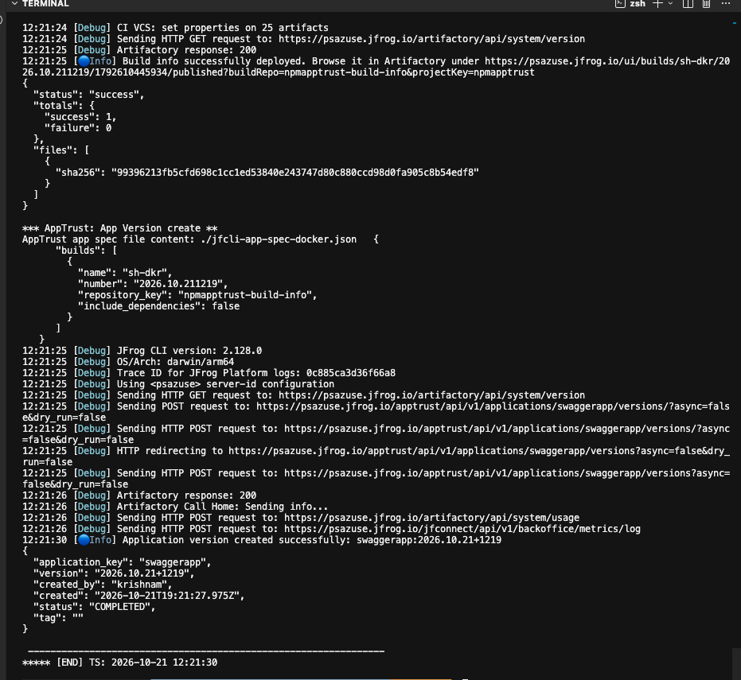
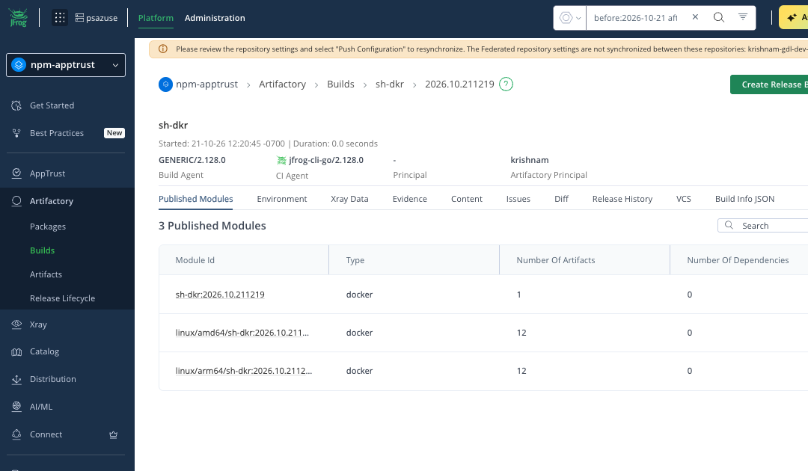

# AppTrust app

## Administration
### Repos


#### Virtual repo
##### Docker

##### NPM


### Lifecycle


## Compliance



## Platform
### Application



## Pipeline: DOCKER 
- Copied ./Dockerfile to ./jfrog/Dockerfile and updated to download image from JFrog
```
#FROM nginx:1.31.6-alpine
# https://hub.docker.com/_/nginx/
FROM psazuse.jfrog.io/npmapptrust-docker-virtual/nginx:1.31.6-alpine
```

## Dev sandbox
### npm command
- build command
```
./jfrog/jfcli.sh npm
```

- output


- RT builds


### Docker command
- build command
```
./jfrog/jfcli.sh dkr
```

- output
 

- RT builds


